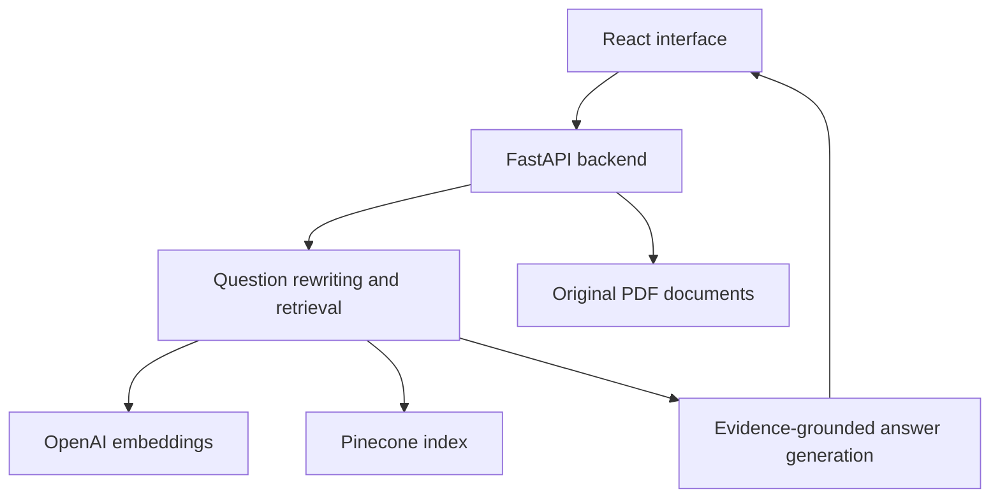

# IronStore AI Assistant

An internal knowledge assistant that helps IronStore employees find product information, understand company policies, and follow internal procedures. Answers use retrieved company documents and link to supporting PDF pages.

Built as an Ironhack AI Engineering mini-project using a synthetic enterprise document collection.

## Live demo

[Open IronStore AI Assistant](https://ironstore-ai-assistant.vercel.app/)

## Features

- Natural-language questions across company departments and product catalogues.
- Page-aware PDF chunking and cached OpenAI embeddings.
- Pinecone semantic retrieval with embedding-configuration filters.
- Evidence-grounded answers with message-specific citations and PDF links.
- Follow-up questions resolved using a bounded conversation history.
- Searchable document library with department filters.
- Responsive dark interface and conversations saved in browser storage.

Citation-ID validation checks that citations refer to supplied sources. It does not independently verify every generated claim.

## Architecture



Ingestion is a separate local workflow: inspect PDFs → prepare page-aware chunks → embed uncached text → upload to Pinecone. It must not run during deployment or application startup.

## Stack and dependencies

| Area | Technology |
| --- | --- |
| Frontend | React, TypeScript, Vite, CSS, lucide-react, react-markdown |
| API | FastAPI, Uvicorn, Pydantic, pydantic-settings |
| RAG | LangChain, langchain-openai, langchain-text-splitters |
| Vector database | Pinecone Python SDK using the Documents API |
| Document processing | pypdf, tiktoken |
| Checks | pytest, httpx, ESLint, TypeScript build |
| Embeddings | text-embedding-3-small with 1024 output dimensions |
| Generation | OpenAI model selected through OPENAI_CHAT_MODEL |

Install the repository's tested versions from `backend/requirements.txt` and `frontend/package-lock.json`. Do not replace them with unverified latest versions. The project has been developed locally with Python 3.14; the deployment runtime must be checked separately.

The Pinecone index must support externally supplied vectors in an `embedding` dense-vector field with 1024 dimensions and cosine similarity, plus a stored `text` field and the metadata used by retrieval. An index configured only for Pinecone-hosted text embeddings is not interchangeable with this configuration.

## Project structure

```text
ironstore-ai-assistant/
├── backend/
│   ├── app/
│   │   ├── main.py
│   │   ├── config.py
│   │   ├── schemas.py
│   │   ├── document_registry.py
│   │   ├── ingestion.py
│   │   ├── vector_store.py
│   │   ├── retrieval.py
│   │   ├── model_service.py
│   │   ├── assistant.py
│   │   └── prompts.py
│   ├── scripts/
│   ├── tests/
│   ├── storage/          # Local generated files; excluded from Git
│   ├── requirements.txt
│   └── .env.example
├── documents/            # Original synthetic PDFs
├── frontend/
│   ├── src/
│   ├── package.json
│   └── package-lock.json
└── README.md
```

## Local setup

Prerequisites: Python compatible with the tested dependencies, Node.js/npm compatible with the frontend, an OpenAI API key, and a Pinecone index/API key.

From the repository root, create a virtual environment if needed:

```bash
python3 -m venv .venv
source .venv/bin/activate
python -m pip install -r backend/requirements.txt
```

Create `backend/.env` using the configuration below. Never commit real keys.

```dotenv
APP_NAME="IronStore AI Assistant"
APP_ENV=development
OPENAI_API_KEY=replace_me
OPENAI_CHAT_MODEL=replace_with_your_available_model
OPENAI_EMBEDDING_MODEL=text-embedding-3-small
OPENAI_EMBEDDING_DIMENSIONS=1024
PINECONE_API_KEY=replace_me
PINECONE_INDEX_NAME=ironstore-openai
PINECONE_NAMESPACE=ironstore-v1
DOCUMENTS_DIR=../documents
STORAGE_DIR=storage
RETRIEVAL_K=6
MAX_HISTORY_MESSAGES=6
MAX_QUESTION_CHARACTERS=4000
ALLOWED_ORIGINS=["http://localhost:5173","http://127.0.0.1:5173"]
```

The vector-store connection resolves the index host from its name. If your checked-in settings still require `PINECONE_INDEX_HOST`, supply the actual host for that same index. Do not reuse an old index's host.

Start the backend:

```bash
cd backend
python -m uvicorn app.main:app --reload
```

API documentation: http://localhost:8000/docs

In another terminal, from the repository root:

```bash
cd frontend
npm ci
```

Create `frontend/.env.local`:

```dotenv
VITE_API_BASE_URL=http://localhost:8000
```

Use the exact variable name read by `src/api.ts`; align the code and environment if it currently differs. Start the frontend:

```bash
npm run dev
```

## Document preparation and ingestion

Run from `backend` with the virtual environment active:

```bash
python -m scripts.check_setup
python -m scripts.inspect_documents
python -m scripts.prepare_chunks --all
python -m scripts.ingest --all
```

Inspection and chunk preparation do not call OpenAI. Ingestion makes billable embedding calls for uncached text and writes records to Pinecone. Existing records are not automatically removed when source files change; document replacement/deletion synchronization is future work.

The dataset contains 83 PDFs and 2,308 pages. Inspection found 52 pages with no extracted text; sampled pages were confirmed blank. Historical catalogues remain in the collection and must be distinguished from current catalogue snapshots. Catalogue data is not live inventory or pricing.

## API

| Method | Endpoint | Purpose |
| --- | --- | --- |
| GET | `/api/documents` | List documents; optional department and title-search filters |
| GET | `/api/documents/{document_id}` | Serve an original PDF |
| POST | `/api/chat` | Answer a question with optional recent history |

Confirm the health-check route in `app/main.py` before configuring external monitoring.

Example chat request:

```json
{
  "question": "How much notice is required to request annual leave?",
  "history": []
}
```

Responses contain `answer`, `sources`, and `limitations`. Each source includes its citation ID, document ID, title, page, excerpt, and PDF URL. Follow-up requests accept up to six prior user/assistant messages. PDF URLs are relative to the backend origin, not the frontend origin.

## Verification

Backend, from `backend`:

```bash
python -m pytest tests/test_document_registry.py -q
```

Frontend, from `frontend`:

```bash
npm run lint
npm run build
```

Also check a policy question, a product SKU, a follow-up, an unsupported question, clickable citations, PDF page links, browser-history persistence, error recovery, and mobile navigation. Confirm long source dialogs are scrollable and readable at normal zoom. Mock-based UI checks do not validate live model answers.

## Deployment

The React frontend and FastAPI backend are deployed as separate Vercel projects. Pinecone stores the embeddings and document chunks, while OpenAI provides embeddings and answer generation.

**Live application:** https://ironstore-ai-assistant.vercel.app/

### Frontend

1. Select the `frontend` root directory and Vite preset.
2. Use the committed lockfile, `npm run build`, and `dist` output.
3. Set `VITE_API_BASE_URL` to the deployed backend HTTPS origin.
4. Redeploy after changing that value because Vite embeds it at build time.
5. If the app uses browser-history routes, configure an SPA fallback and verify direct navigation/reload. Do not add a fallback blindly if it only uses component state.

### Backend changes to verify and apply

1. Select a Python runtime supported by Vercel and test the existing requirements in a clean environment using that runtime. Do not assume local Python 3.14 support implies deployment support.
2. Ensure the deployment installs `backend/requirements.txt`. Preserve the tested Pinecone SDK Documents API support. Do not add `langchain-pinecone` or downgrade the SDK for deployment.
3. Expose the existing FastAPI `app` through an entry point recognized by Vercel. One possible repository-root adapter is `api/index.py` containing `from backend.app.main import app`, but the current backend uses absolute `from app...` imports: those must be resolved consistently before this adapter can work. Do not paste this adapter without checking imports and current Vercel guidance.
4. Choose a project root/build layout that includes both backend code and the top-level `documents` directory. A backend-only deployment root may omit the sibling PDFs. Do not change document relative paths, because the registry derives IDs from them.
5. Verify `config.py` resolves `DOCUMENTS_DIR` against a known project/backend path rather than the process working directory. Serve bundled PDFs read-only. If the bundle is too large, move originals to object storage and adapt the document endpoint.
6. Exclude `.venv`, `frontend/node_modules`, generated caches, inspection reports, tests not needed at runtime, and local secrets from the backend artifact. Do not exclude the PDFs if the document endpoint still reads them locally.
7. Confirm no startup path performs ingestion, recreates indexes, or requires writable persistent storage. Use temporary storage only for disposable runtime files.
8. Add backend environment variables through the hosting dashboard: OpenAI key/model, embedding model/dimensions, Pinecone key/index/namespace, production origins, and verified document-path settings.
9. Set `ALLOWED_ORIGINS` to a JSON array containing the actual deployed frontend origin. Add preview origins deliberately if needed; do not assume production CORS settings cover previews.
10. Check request duration and cold-start behavior with a real chat request. Add access protection or server-enforced usage limits before broadly sharing a billable endpoint. CORS is not access control.

The backend is not launched with a permanent `uvicorn --reload` process on Vercel. Vercel runs its supported Python/ASGI entry point. No extra Vercel-specific Python library should be added without a documented need.

Do not commit a guessed `vercel.json`: its entry point, file inclusion, and route behavior must match the actual repository and current deployment platform. If the backend fails package/runtime constraints, deploy FastAPI to a suitable backend host while retaining the Vercel frontend and Pinecone database.

### Post-deployment checks

- Document listing returns the expected 83 records.
- A known PDF returns `application/pdf`; the page link opens correctly.
- A live chat request succeeds from the deployed frontend.
- A follow-up preserves the intended topic.
- Production CORS accepts the frontend origin.
- Secrets are absent from frontend assets, Git history, and logs.
- Cold-start/loading/error states are understandable.

## Limitations and next steps

- No authentication, employee permissions, or server-side conversation storage yet.
- No agent search/read loop or token streaming yet.
- Retrieval is semantic; hybrid retrieval and reranking are planned.
- Missing/conflicting evidence is currently handled through prompts and limitations, rather than a dedicated evidence-status schema.
- Broad answer-quality evaluation and prompt-injection testing are pending.
- Source citation validity does not guarantee factual correctness.
- Local browser conversations are device/browser specific.
- OpenAI calls incur costs, including query rewriting for follow-ups.

## Data and secrets

The documents are synthetic bootcamp materials. Confirm redistribution permission before publishing them in a public repository; synthetic does not automatically mean openly licensed. 
